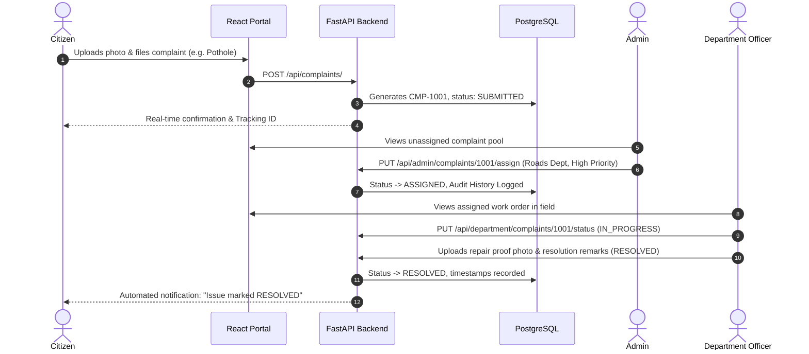

# 🏙️ Smart City Complaint & Infrastructure Management System (DevOps Edition)

[](https://github.com/codexashu/smart-city-devops/actions/workflows/ci-cd.yml)
[](https://www.docker.com/)
[](https://kubernetes.io/)
[](https://prometheus.io/)
[](https://grafana.com/)
[](https://www.terraform.io/)
[](https://trivy.dev/)

An enterprise-grade, production-style DevOps platform for municipal infrastructure maintenance and citizen grievance redressal. Citizens register public defects (potholes, water leaks, electrical hazards), administrators assign priorities and dispatch work to municipal departments, and field crews resolve issues with before/after photo verification.

Behind the application lies an automated **DevSecOps delivery pipeline**, **Kubernetes self-healing cluster**, **Prometheus/Grafana live monitoring**, **Terraform AWS cloud provisioning**, and **Ansible configuration management**.

---

## 🏛️ System Architecture

```
                                  [ CITIZENS / ADMINS / CREW ]
                                                │
                                                ▼
                                    [ Ingress / Nginx ALB ]
                                                │
                     ┌──────────────────────────┴──────────────────────────┐
                     ▼                                                     ▼
           [ React.js Frontend ]                                 [ FastAPI REST Backend ]
           (Nginx Alpine Container)                              (Multi-stage Non-root Pod)
                                                                           │
                                              ┌────────────────────────────┼────────────────────────────┐
                                              ▼                            ▼                            ▼
                                     [ PostgreSQL DB ]              [ Redis Cache ]             [ Prometheus Scraper ]
                                     (Stateful PVC)                 (In-Memory Cache)           (Port 8000 /metrics)
                                                                                                        │
                                                                                                        ▼
                                                                                               [ Grafana Dashboard ]
```

---

## 🔁 Real-World Civic Workflow



---

## 🛠️ Technology Stack

| Layer | Technology | Key Responsibility |
|---|---|---|
| **Frontend** | React.js 18 + Lucide Icons | Responsive civic portal, live progress tracking, role switching |
| **Backend** | Python FastAPI + SQLAlchemy | Async REST API, JWT authentication, Prometheus instrumentation |
| **Database** | PostgreSQL 15 | Relational storage for complaints, audit trails, and departments |
| **Cache** | Redis 7 | High-performance query caching with graceful fallback |
| **Containers** | Docker (Multi-stage) | Lean non-root images with minimal attack surface |
| **Orchestration** | Kubernetes (K8s) | Deployments, Rolling updates, Ingress, Services, ConfigMaps |
| **Autoscaling** | Kubernetes HPA | Dynamic horizontal pod scaling based on CPU & memory |
| **CI/CD** | GitHub Actions | Automated lint, Pytest, Docker build, and K8s rolling deployment |
| **Code Quality** | SonarQube | Static code analysis & maintainability gate |
| **Security** | Trivy Container Scanner | Vulnerability scanner for CVEs and secret leaks |
| **Cloud IaC** | Terraform | AWS VPC, Subnets, Security Groups, S3 and EC2 provisioning |
| **Configuration** | Ansible | Automated package installation, firewall, and runtime setup |
| **Monitoring** | Prometheus + Grafana | Metrics scraping, latency percentiles, and live dashboards |
| **Logging** | Elasticsearch + Kibana | Centralized logging and container log shipping |

---

## 📂 Project Repository Structure

```
smart-city-devops/
├── backend/
│   ├── app/
│   │   ├── models/            # User, Department, Complaint, Audit History
│   │   ├── routes/            # Auth, Complaints, Admin, Department, Notifications
│   │   ├── services/          # JWT Auth, Redis Cache, Business logic
│   │   ├── utils/             # Prometheus metrics middleware
│   │   ├── config.py          # Environment settings
│   │   ├── database.py        # SQLAlchemy engine with SQLite fallback
│   │   └── main.py            # FastAPI entrypoint & auto-seeding
│   ├── tests/                 # Comprehensive Pytest suite
│   ├── Dockerfile             # Multi-stage production build
│   └── requirements.txt
├── frontend/
│   ├── src/
│   │   ├── components/        # Navbar, Badges, Cards, Interactive Modals
│   │   ├── context/           # AuthContext with 1-click Demo Switcher
│   │   └── pages/             # Citizen, Admin, Department, Analytics
│   ├── nginx.conf             # Production reverse proxy config
│   ├── Dockerfile             # Multi-stage Node + Nginx Alpine
│   └── package.json
├── database/
│   ├── schema.sql             # Production PostgreSQL DDL
│   └── seed.sql               # Seed data for immediate demo
├── kubernetes/
│   ├── namespace.yaml
│   ├── configmap.yaml
│   ├── secrets.yaml
│   ├── postgres-deployment.yaml
│   ├── redis-deployment.yaml
│   ├── backend-deployment.yaml
│   ├── backend-hpa.yaml       # Autoscaling (Min: 2, Max: 10)
│   ├── frontend-deployment.yaml
│   ├── ingress.yaml
│   └── kustomization.yaml
├── terraform/
│   ├── main.tf                # AWS VPC, Security Groups, S3, EC2
│   ├── variables.tf
│   └── outputs.tf
├── ansible/
│   ├── playbook.yml           # Host configuration playbook
│   └── roles/                 # Common, Docker, App Deploy
├── monitoring/
│   ├── prometheus.yml         # Scrape configuration
│   └── grafana/               # Auto-provisioned datasource & dashboard
├── logging/
│   ├── docker-compose.logging.yml # ELK Stack
│   └── filebeat.yml
├── .github/workflows/
│   └── ci-cd.yml              # 5-stage DevSecOps pipeline
├── scripts/
│   ├── seed-data.py           # Seed realistic civic data
│   ├── start-local.sh         # 1-command startup
│   ├── run-tests.sh           # Test suite execution
│   └── k8s-deploy.sh          # One-click Kubernetes deployment
└── README.md
```

---

## ⚡ Quickstart Guide

### Option A: 1-Command Startup with Docker Compose (Recommended)

```bash
# Clone the repository
git clone https://github.com/codexashu/smart-city-devops.git
cd smart-city-devops

# Launch the complete stack
docker compose up -d --build
```

**Services will be live at:**
- 🌐 **Citizen & Admin Portal:** [http://localhost:3000](http://localhost:3000)
- 🔌 **FastAPI Swagger Docs:** [http://localhost:8000/docs](http://localhost:8000/docs)
- 📊 **Prometheus Metrics:** [http://localhost:9090](http://localhost:9090)
- 📈 **Grafana Dashboards:** [http://localhost:3001](http://localhost:3001) *(User: `admin` | Password: `admin`)*
- 🩺 **Health Check:** [http://localhost:8000/health](http://localhost:8000/health)

---

### Option B: Local Standalone Development (Without Docker)

#### 1. Start Backend:
```bash
cd backend
python3 -m venv venv
source venv/bin/activate
pip install -r requirements.txt

# Run server (automatically seeds demo admin, officer, and citizen)
uvicorn app.main:app --reload --port 8000
```

#### 2. Start Frontend:
```bash
cd frontend
npm install
npm start
```

---

## 🔐 Built-in Demo Credentials

The platform features a **1-Click Demo Switcher** at the top of the portal to switch roles instantly:

| Role | Email | Password | Responsibility |
|---|---|---|---|
| **Citizen** | `citizen@smartcity.gov` | `Citizen@12345` | File complaints, upload photos, track progress |
| **Admin** | `admin@smartcity.gov` | `Admin@12345` | Assign to departments, set priority, monitor SLAs |
| **Roads Officer** | `officer.roads@smartcity.gov` | `Officer@12345` | Update field work, upload resolution proof |

---

## ☸️ Kubernetes Deployment & Self-Healing

Apply the complete manifests in a single command using Kustomize:

```bash
# Deploy entire platform to Kubernetes
kubectl apply -k kubernetes/

# Verify running pods
kubectl get pods -n smartcity

# Test Horizontal Pod Autoscaling
kubectl get hpa -n smartcity
```

### 🛡️ Simulating Pod Failure & Self-Healing (Interview Demo):
```bash
# Delete a running backend pod to test self-healing
kubectl delete pod -l app=backend -n smartcity

# Watch Kubernetes immediately provision a fresh replacement pod
kubectl get pods -n smartcity -w
```

### 🔄 Zero-Downtime Rollback:
```bash
# Roll back to the previous stable release instantly
kubectl rollout undo deployment/backend-deployment -n smartcity
kubectl rollout status deployment/backend-deployment -n smartcity
```

---

## ☁️ Terraform AWS Infrastructure Provisioning

```bash
cd terraform

# Initialize Terraform AWS provider
terraform init

# Review execution plan
terraform plan

# Provision VPC, EC2, S3 & Security Groups on AWS
terraform apply -auto-approve
```

---

## 🧪 Running Automated Tests

```bash
# Run backend pytest suite with test coverage
./scripts/run-tests.sh
```

---

## 🎤 Interview Demonstration Script

When presenting this project in a DevOps or full-stack interview:

1. **Introduction:** *"I engineered a production-style Smart City Infrastructure platform designed from the ground up for high availability, automated CI/CD delivery, and container orchestration."*
2. **Citizen Submission:** Log in as Citizen, file a complaint for a *Pothole on Express Highway*, upload photo evidence, and demonstrate real-time complaint ID generation (`CMP-1001`).
3. **Admin Assignment:** Use the top 1-click switcher to toggle to Admin. Show the municipal command dashboard, review the issue, and assign it to the **Roads & Bridges** department with **High** priority.
4. **Field Resolution:** Switch to the Roads Officer. Show the assigned work order, transition the status to `IN_PROGRESS`, and mark it `RESOLVED` with resolution notes. Show how the citizen's view updates automatically.
5. **DevOps Automation:** Walk through `.github/workflows/ci-cd.yml` showing Pytest testing, SonarQube quality gate, and Trivy CVE scanning.
6. **Kubernetes & Self-Healing:** Open terminal, execute `kubectl delete pod`, and demonstrate Kubernetes self-healing recreating the pod with zero downtime. Show the HPA autoscaling configuration and Grafana telemetry dashboards.
